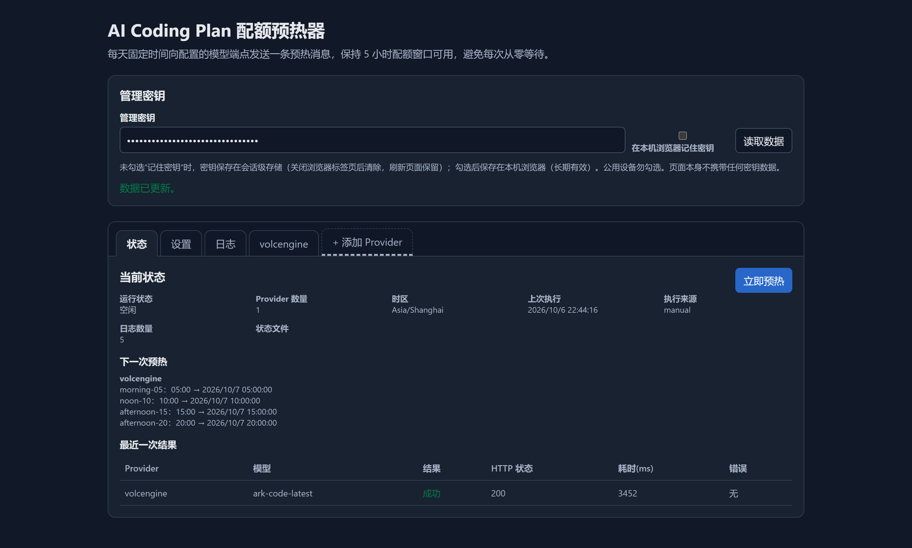

# AI Coding Plan 5小时配额预热器

独立部署的 Go 服务：每天在固定时间点向配置的模型端点发送一条预热消息，保持火山引擎 AI Coding Plan 等按 5 小时滚动窗口计费的订阅"温热"，避免长时间不用后每次都要重新等待一个完整窗口。



设计参考 [codex-5h-quota-warmer](https://github.com/Windyskr/codex-5h-quota-warmer)（CLIProxyAPI 插件），本项目改为独立服务：直接对你在配置中提供的 API URL 发请求，不依赖任何代理。参考项目源码存档在 [ref/](ref/)。

## 特性

- **每天固定时间预热**：`schedules` 配置多行 `HH:MM`，按 IANA 时区每天执行一次（例如 05:00 / 10:00 / 15:00 正好间隔 5 小时）。启动时不执行预热，只等待下一次计划时间。支持**全局兜底日程 + 每账号专属日程**：账号未设置专属日程时使用全局日程，设置后仅按专属日程预热。
- **多账号**：`accounts` 列表配置任意多个订阅账号，每个 Provider 在管理页一个独立标签；可用**别名**自定义标签显示名。
- **密钥支持环境变量**：`QUOTA_WARMER_API_KEY_<PROVIDER>`（provider 转大写、非字母数字替换为下划线，如 `mock-claude` → `QUOTA_WARMER_API_KEY_MOCK_CLAUDE`），启动时优先于配置文件中的 `api_key`。
- **直接请求任意端点**：填写完整 endpoint URL，`api_format` 选择请求格式（`openai` 或 `anthropic`），界面提供火山常用端点一键填入。
- **Web 管理页面**：中文界面，输入管理密钥后可查看状态、立即预热、编辑日程与设置、按 Provider 筛选运行日志。
- **可扩展**：预热请求构造抽象为 `RequestBuilder` 接口（[provider.go](provider.go)），未来支持其他 coding plan 只需注册新的 builder。
- **资源占用小**：单静态二进制（内嵌页面），Docker 镜像约 15–20MB，运行内存 ~15MB，适合 VPS。

## 快速开始（Docker）

最短路径三步（完整步骤与说明见下方「Docker 镜像构建与部署」章节）：

```bash
cp .env.example .env                  # 编辑 QUOTA_WARMER_MANAGEMENT_KEY 为强随机串
$EDITOR config.yaml                   # 填入 api_url 与 model（api_key 也可由环境变量注入）
docker compose up -d                  # 拉取镜像运行（本地构建则用 -f docker-compose-build.yml，见下）
```

打开 `http://你的VPS:1688/`，输入管理密钥即可进入管理页面。

> 生产环境建议在前面加 HTTPS 反向代理（Nginx/Caddy），管理密钥经明文 HTTP 传输时存在被窃听风险。

### 生成强随机串

管理密钥（`QUOTA_WARMER_MANAGEMENT_KEY`）必须是强随机串，不要使用密码或可猜测的短语。各平台生成 32 位十六进制随机串（128 bit 熵）的命令：

```bash
openssl rand -hex 16                                   # Linux / macOS / Windows(Git Bash)
head -c 16 /dev/urandom | xxd -p                       # Linux / macOS（无 openssl 时）
python -c "import secrets; print(secrets.token_hex(16))"  # 任意平台有 Python 时
```

Windows PowerShell（无 Git Bash 时）：

```powershell
-join ((1..32) | ForEach-Object { '{0:x}' -f (Get-Random -Max 16) })
```

> 注意：`Get-Random` 基于伪随机，安全性弱于上面几种方式，仅在没有任何其他工具时应急使用；更稳妥的是在 PowerShell 里调用 .NET 加密随机数：
>
> ```powershell
> [BitConverter]::ToString([Security.Cryptography.RandomNumberGenerator]::GetBytes(16)).Replace("-","").ToLower()
> ```

## Docker 镜像构建与部署

源码在 `src/` 下，Dockerfile 与两份 compose 文件在项目根目录：

| 文件                       | 用途                                                                                  |
| -------------------------- | ------------------------------------------------------------------------------------- |
| `docker-compose.yml`       | **默认**：直接拉取远端镜像（Docker Hub / GHCR）运行，不做本地构建。镜像发布后开箱即用 |
| `docker-compose-build.yml` | 本地从 `src/` 源码构建镜像并运行，适合自行修改代码或镜像尚未发布时                    |

构建时 Docker 只把 `src/` 送进构建阶段（多阶段构建：`golang:1.23-alpine` 编译 → `alpine:3.20` 运行），根目录的配置、dist/ 产物等均被 `.dockerignore` 排除，不会进入镜像。

### 方式一：docker compose

**拉取远端镜像运行（默认，docker-compose.yml）**：

> ghcr.io/becase/coding-plan-5h-quota-warmer:latest

```bash
# 1. 准备环境变量（管理密钥必须强随机，生成方式见「生成强随机串」）
cp .env.example .env
$EDITOR .env

# 2. 准备配置（至少填好 api_url 与 model；api_key 可留待环境变量注入）
$EDITOR config.yaml

# 3. 拉取镜像并启动
docker compose up -d

# 4. 查看日志 / 健康检查
docker compose logs -f
curl -s http://127.0.0.1:1688/healthz

# 升级到新版本镜像
docker compose pull && docker compose up -d

# 停止
docker compose down
```

**本地构建源码运行（docker-compose-build.yml）**：

```bash
docker compose -f docker-compose-build.yml up -d --build   # --build 每次重新编译 src/ 下的源码
docker compose -f docker-compose-build.yml logs -f         # 查看日志
docker compose -f docker-compose-build.yml down            # 停止
```

两份 compose 文件的挂载与环境变量完全一致：

- `./config.yaml:/app/config.yaml`（**可写**挂载）：管理页面保存设置会写回宿主机此文件
- `./data:/app/data`：运行状态持久化（上次执行时间、结果、日志），容器重建不丢
- `.env` 通过 `env_file` 进入容器：`QUOTA_WARMER_MANAGEMENT_KEY` 与各账号 `QUOTA_WARMER_API_KEY_*`

### 方式二：手动 docker build / docker run

```bash
# 在项目根目录执行（Dockerfile 在根目录，构建上下文为整个项目根，
# 但 .dockerignore 已排除无关文件，实际只有 src/ 会进入构建阶段）
docker build -t coding-plan-5h-quota-warmer:latest .

# 运行（不依赖 compose）
docker run -d --name quota-warmer \
  -p 1688:1688 \
  -v "$PWD/config.yaml:/app/config.yaml" \
  -v "$PWD/data:/app/data" \
  -e QUOTA_WARMER_MANAGEMENT_KEY=强随机串 \
  coding-plan-5h-quota-warmer:latest
```

**账号密钥（api_key 环境变量）的传入方式**：

```bash
# 方式 A：--env-file 整个 .env 注入（推荐，与 compose 的 env_file 行为一致）
# .env 中取消注释并填写各账号密钥（KEY=VALUE 每行一条，值不要加引号）：
#   QUOTA_WARMER_MANAGEMENT_KEY=强随机串
#   QUOTA_WARMER_API_KEY_VOLCENGINE=ark-xxxx
docker run -d --name quota-warmer \
  -p 1688:1688 \
  -v "$PWD/config.yaml:/app/config.yaml" \
  -v "$PWD/data:/app/data" \
  --env-file .env \
  coding-plan-5h-quota-warmer:latest

# 方式 B：-e 逐个传入（账号少时）
docker run -d --name quota-warmer \
  -p 1688:1688 \
  -v "$PWD/config.yaml:/app/config.yaml" \
  -v "$PWD/data:/app/data" \
  -e QUOTA_WARMER_MANAGEMENT_KEY=强随机串 \
  -e QUOTA_WARMER_API_KEY_VOLCENGINE=ark-xxxx \
  coding-plan-5h-quota-warmer:latest
```

`--env-file` 格式注意：每行 `KEY=VALUE`；`#` 开头注释行被忽略（被注释掉的密钥**不会生效**，使用前取消注释）；值不要用引号包裹（引号会被当作值的一部分）。

验证变量已进容器：

```bash
docker exec quota-warmer env | grep QUOTA_WARMER
```

> 若某账号既没有环境变量、config.yaml 里也没写 `api_key`，容器启动即失败（`docker logs quota-warmer` 可见 `api_key is required`）。

### 修改代码后重建

```bash
# src/ 下任意 .go 或 web/index.html 改动后：
docker compose -f docker-compose-build.yml up -d --build    # compose 方式
# 或
docker build -t coding-plan-5h-quota-warmer:latest . && docker rm -f quota-warmer && docker run -d ... # 手动方式
```

> 提示：`web/index.html` 通过 `go:embed` 内嵌进二进制，改前端也必须重新 build 镜像，仅重启容器不生效。

### 镜像信息

- 多阶段构建：`golang:1.23-alpine`（编译，`CGO_ENABLED=0` 静态链接）→ `alpine:3.20`（运行）
- 最终镜像约 15–20MB，包含 ca-certificates 与 tzdata
- 容器以非 root 用户 `warmer`（uid 10001）运行，`EXPOSE 1688`
- HEALTHCHECK 每 30s 探测 `/healthz`

## 本地构建运行

需要 Go ≥ 1.19（在 `src/` 目录下构建）：

```bash
cd src
go build -o ../dist/coding-plan-5h-quota-warmer-windows-amd64.exe .
cd ..
QUOTA_WARMER_MANAGEMENT_KEY=test-key ./dist/coding-plan-5h-quota-warmer-windows-amd64.exe -config config.yaml
```

## 预编译二进制（dist/）

仓库提供两个平台的预编译产物（构建命令含 `-trimpath -ldflags "-s -w"`，静态链接、无运行时依赖）：

| 文件                                                 | 平台                      | 大小    |
| ---------------------------------------------------- | ------------------------- | ------- |
| `dist/coding-plan-5h-quota-warmer-windows-amd64.exe` | Windows x64               | ~7.8 MB |
| `dist/coding-plan-5h-quota-warmer-linux-amd64`       | Linux x64（VPS 直接运行） | ~7.6 MB |

Linux 上传到 VPS 后：

```bash
chmod +x coding-plan-5h-quota-warmer-linux-amd64
QUOTA_WARMER_MANAGEMENT_KEY=$(openssl rand -hex 16) ./coding-plan-5h-quota-warmer-linux-amd64 -config config.yaml
# 强随机串的生成方式见上方「生成强随机串」一节
```

> 二进制内嵌管理页面，部署时只需一个可执行文件 + `config.yaml`。`dist/` 已加入 `.gitignore`，重新构建覆盖即可。

自己重新构建发布产物：

```bash
cd src
GOOS=windows GOARCH=amd64 go build -trimpath -ldflags "-s -w" -o ../dist/coding-plan-5h-quota-warmer-windows-amd64.exe .
GOOS=linux   GOARCH=amd64 CGO_ENABLED=0 go build -trimpath -ldflags "-s -w" -o ../dist/coding-plan-5h-quota-warmer-linux-amd64 .
```

## 配置说明（config.yaml）

| 字段                    | 默认值              | 说明                                                                                                                                                                                                                                                                               |
| ----------------------- | ------------------- | ---------------------------------------------------------------------------------------------------------------------------------------------------------------------------------------------------------------------------------------------------------------------------------- |
| `listen`                | `":1688"`           | HTTP 监听地址                                                                                                                                                                                                                                                                      |
| `management_key`        | 空                  | 管理密钥；环境变量 `QUOTA_WARMER_MANAGEMENT_KEY` 优先；两者都为空时管理接口停用                                                                                                                                                                                                    |
| `timezone`              | `"Asia/Shanghai"`   | 日程解析使用的 IANA 时区                                                                                                                                                                                                                                                           |
| `max_log_entries`       | `200`               | 运行日志保留条数上限（≤2000）                                                                                                                                                                                                                                                      |
| `state_file`            | `"data/state.json"` | 运行状态持久化文件（原子写入）                                                                                                                                                                                                                                                     |
| `accounts[]`            | 必填至少 1 个       | 账号列表，预热时依次请求所有账号。每项字段见下（api_key 可由环境变量替代，见下方专节）                                                                                                                                                                                             |
| `accounts[].provider`   | 必填                | Provider 标识（唯一、可任意取值），同时用于环境变量名 `QUOTA_WARMER_API_KEY_<PROVIDER>`                                                                                                                                                                                            |
| `accounts[].alias`      | 空                  | 别名（可选）。设置后管理页标签页显示别名，否则显示 provider 标识                                                                                                                                                                                                                   |
| `accounts[].api_url`    | 必填                | API 地址：填 Base URL 或完整端点均可。openai 格式自动补全 `/chat/completions`，anthropic 格式自动补全 `/v1/messages`。火山 Coding Plan：`https://ark.cn-beijing.volces.com/api/coding/v3`（OpenAI 兼容）或 `https://ark.cn-beijing.volces.com/api/coding`（Claude/Anthropic 兼容） |
| `accounts[].api_format` | `"openai"`          | `openai`：`Authorization: Bearer` + `{model,messages,stream:false}`；`anthropic`：`x-api-key` + `anthropic-version` + `{model,max_tokens,messages}`                                                                                                                                |
| `accounts[].api_key`    | 必填\*              | API 密钥，只出现在请求头，日志与状态文件不落盘。可改用环境变量 `QUOTA_WARMER_API_KEY_<PROVIDER>` 注入（启动时优先于本字段；两者都提供时环境变量生效，因此用环境变量注入时本字段可省略）                                                                                            |
| `accounts[].model`      | 必填                | 预热使用的模型 ID                                                                                                                                                                                                                                                                  |
| `accounts[].prompt`     | 必填                | 预热消息内容，默认 `"hello"`                                                                                                                                                                                                                                                       |
| `accounts[].schedules`  | 空                  | 该账号专属日程（可选）。为空时使用下方全局兜底日程；非空时**覆盖**全局日程                                                                                                                                                                                                         |
| `schedules[]`           | 三个示例            | 全局兜底日程 `{id, at: "HH:MM", enabled}`；id 不可重复，多个**启用**行的时间不可重复                                                                                                                                                                                               |

### 账号密钥环境变量（大小写与命名规则）

环境变量名格式：`QUOTA_WARMER_API_KEY_<PROVIDER>`，转换规则：

1. **provider 配置值会被自动转为小写归一**——配置里写 `Volcano` / `VOLCANO` / `volcano` 都会归一为小写 `volcano`，不影响环境变量匹配
2. **环境变量名固定全大写**——查找时对 provider 做 `ToUpper` 转换，最终变量名永远是全大写字母 + 数字 + 下划线
3. **非字母数字字符（`-`、`.` 等）替换为下划线**

转换示例：

| config.yaml 里的 provider | 需要设置的环境变量                   |
| ------------------------- | ------------------------------------ |
| `volcano`                 | `QUOTA_WARMER_API_KEY_VOLCANO`       |
| `Volcano`（任意大小写）   | `QUOTA_WARMER_API_KEY_VOLCANO`       |
| `mock-claude`             | `QUOTA_WARMER_API_KEY_MOCK_CLAUDE`   |
| `my.provider_2`           | `QUOTA_WARMER_API_KEY_MY_PROVIDER_2` |

注意事项：

- **Linux/macOS 环境变量名区分大小写**，必须全大写；Windows 的环境变量名不区分大小写，但建议统一用全大写保持跨平台一致
- 环境变量**只在服务启动时读取一次**；启动后通过管理页面保存设置会把当前生效的密钥（含环境变量注入的）写回 `config.yaml`，介意密钥落盘的话请只做查询/预热操作，不点保存
- 在管理页面修改 provider 标识后，记得同步调整对应环境变量名，否则下次重启该账号会因 `api_key is required` 启动失败

## 管理页面

- **管理密钥**：默认保存在会话级存储（刷新页面保留，关闭标签页清除）；勾选"记住密钥"后存 localStorage 长期保留（公用设备勿勾）。未输入密钥时下方内容全部隐藏。页面本身不携带任何密钥数据。
- **标签页**：状态 / 设置 / 日志为固定标签（打开页面默认显示**状态**）；**每个 Provider 一个独立标签**（有别名显示别名，否则显示 provider 标识），可添加、删除、重命名（改名后保存即更新标签名）。
- **状态标签**：运行状态、Provider 数量、下次预热时间表（按 Provider 分组显示各自生效的日程）、最近一次结果（Provider/模型/HTTP 状态/耗时/错误）、"立即预热"按钮（运行中重复点击返回 409）。
- **设置标签**：时区、日志上限、全局兜底日程增删改。
- **日志标签**：运行日志列表，可按 Provider 筛选。
- **Provider 标签**：Provider 标识、别名、API 地址（含火山端点预设按钮）、请求格式、模型、API 密钥（**write-only**：留空表示沿用当前密钥）、预热消息、该账号专属日程。
- **保存设置**即时生效：调度器热重载，且写回挂载的 `config.yaml`，容器重启后配置不丢。

## 管理 API

除 `/healthz`、`/api/meta` 外均需 `Authorization: Bearer <管理密钥>`：

```text
GET  /healthz          健康检查（无认证）
GET  /api/meta         版本与管理接口是否启用（无认证）
GET  /api/status       运行状态 + 下次执行时间表
GET  /api/config       当前配置（api_key 脱敏）
PUT  /api/config       保存配置（热重载；api_key 留空表示不修改）
POST /api/run          立即预热（并发触发返回 409）
GET  /api/logs         运行日志
```

示例：

```bash
KEY=your-management-key
curl -s -H "Authorization: Bearer $KEY" http://localhost:1688/api/status
curl -s -X POST -H "Authorization: Bearer $KEY" http://localhost:1688/api/run
```

## 安全设计

- 管理密钥校验使用 SHA-256 + `subtle.ConstantTimeCompare`，无长度泄漏。
- API 密钥只用于请求头；日志字段过滤 `token`/`secret`/`authorization`/`api_key`；错误文本做密钥替换脱敏；状态文件中错误详情替换为通用文案。
- 容器以非 root 用户运行，状态目录权限 0700。

## 本地验证

起一个 mock 端点（POST 返回 200）：

```bash
python -m mock_endpoint 8000   # 或任意返回 200 的 OpenAI 兼容 mock
```

```python
# mock_endpoint.py
from http.server import BaseHTTPRequestHandler, HTTPServer
import json
class H(BaseHTTPRequestHandler):
    def do_POST(self):
        body = json.dumps({"choices":[{"message":{"content":"ok"}}]}).encode()
        self.send_response(200)
        self.send_header("Content-Type", "application/json")
        self.end_headers()
        self.wfile.write(body)
    def log_message(self, *a): pass
HTTPServer(("127.0.0.1", 8000), H).serve_forever()
```

把测试配置的 `api_url` 指向 `http://127.0.0.1:8000/v1/chat/completions`，启动服务后在管理页面点"立即预热"，应看到成功结果与耗时；`data/state.json` 中不应出现任何密钥内容。

## 目录结构

```
├── src/                # Go 源码（go.mod 与全部 .go 文件在此目录下构建）
│   └── web/index.html      # 内嵌管理页面（go:embed，改动需重新编译）
├── dist/               # 预编译二进制（Windows / Linux，不入库）
├── ref/                # 参考项目 codex-5h-quota-warmer 源码存档（不参与编译）
├── Dockerfile               # 多阶段构建：golang:1.23-alpine 编译 src/ → alpine:3.20 运行
├── docker-compose.yml       # 默认：拉取远端镜像（Docker Hub / GHCR）运行，不本地构建
├── docker-compose-build.yml # 备用：本地从 src/ 源码构建镜像并运行
├── .dockerignore            # 排除根目录无关文件，构建上下文只保留 src/
├── config.yaml              # 运行配置（容器内挂载到 /app/config.yaml，可写）
└── .env(.example)           # 管理密钥与账号密钥环境变量
```
